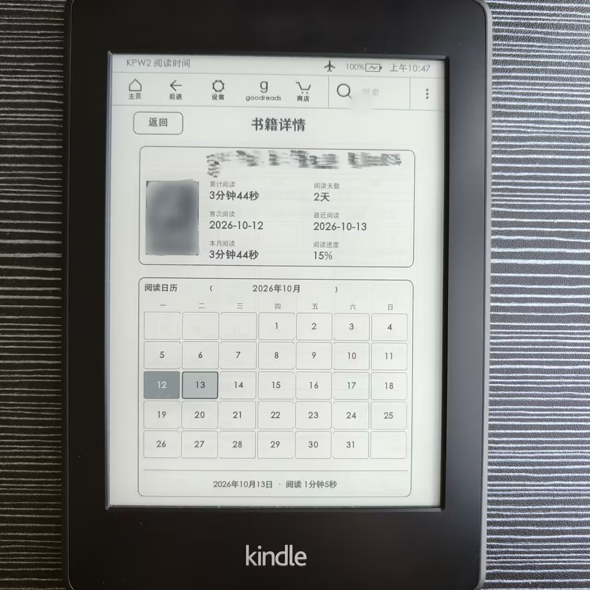
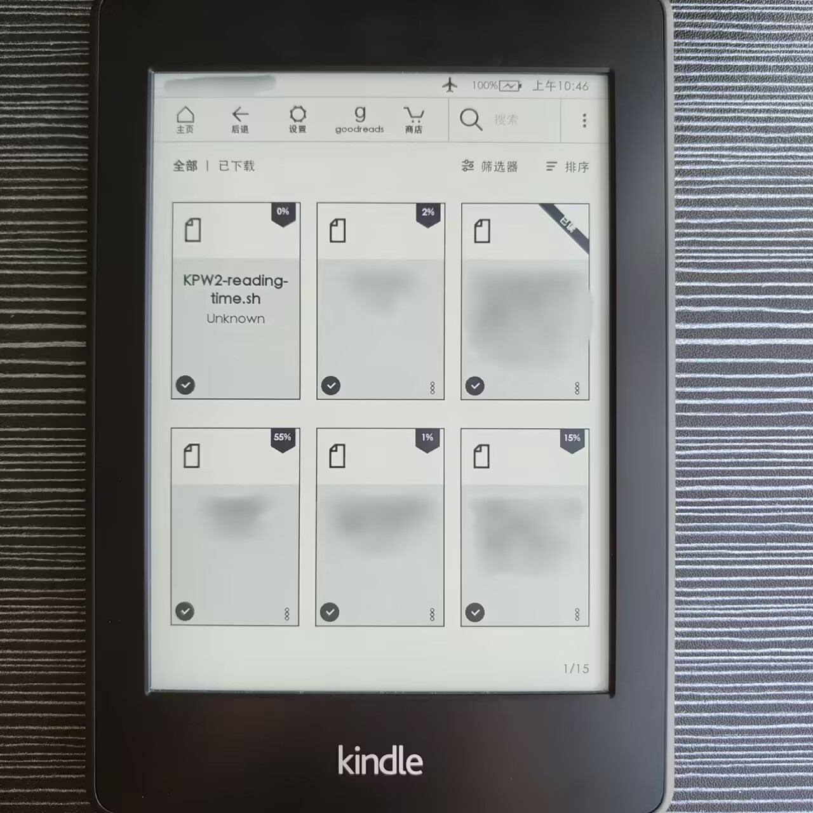

# KPW2 Reading Time

一个跑在 **Kindle Paperwhite 2（KPW2）原生系统**上的「阅读时长统计」仪表盘。
它记录你在原生阅读器里每本书读了多少时间，并在墨水屏上以原生 WebView 应用的方式展示：

- **每日时长**：月历热力图（读得越多格子越深）+ 当日速览下钻。
- **阅读书籍**：按「近 7 日 / 本月 / 今年」筛选，带真实封面与进度条，点书可看「这本书哪天读了多久」的阅读日历。
- **累计时长**：总时长 / 阅读天数 / 日均，以及本周或今年的柱状图。

设计对齐 Kindle 原生日历（ui‑calendar）风格，黑白墨水屏、不滚动、固定居中。

## 界面预览（真机实拍）

| 每日时长 | 阅读书籍 |
|---|---|
|  |  |

| 累计时长 | 书籍详情（阅读日历） |
|---|---|
|  |  |

| 阅读详情（某天下钻） | 安装后在书库中的入口 |
|---|---|
|  |  |

> 截图为真实设备实拍，书名与封面已做打码处理。

> 隐私：所有阅读记录只存在你的 Kindle 本地（`kpw2-reading-time/reading-time.tsv`），不上传任何云端、不含任何网络请求。

---

## 适用设备与前提

- **Kindle Paperwhite 2**（代号 pinot），已 **越狱（jailbreak）**。
- 固件 5.12.x 系列（本项目实际验证于 5.12.2.2）。更老的 5.12 或相近版本通常也行，但未经测试。
- 设备需具备：可 `mntroot rw` 改写只读系统分区、`initctl`(Upstart)、`sqlite3`、`lipc‑get‑prop`（原生框架）。
- 安装方式依赖 **KUAL**（Kindle Unified Application Launcher）。

> 未越狱、或无法 remount 系统分区的设备无法使用。

---

## 安装

1. 下载本仓库，**把仓库里的文件整体复制到 Kindle 通过 USB 挂载出来的磁盘根目录**（也就是 `mnt/us/`）。
   复制后，磁盘根目录应至少能看到：`RUNME.sh`、`extensions/`、`kpw2-reading-time/`、`documents/`。
2. 安全弹出 Kindle，等它退出 USB 模式回到主界面。
3. 在 Kindle 搜索栏输入 `;log runme` 并搜索（这是 KUAL 触发根目录 `RUNME.sh` 的方式）。
   - 第一次会执行完整安装（注册原生 WebView 应用、装后台计时服务、生成数据并打开仪表盘）。
   - 之后每次 `;log runme` 都只是「打开」，不再重装，几秒内即可看到界面。
4. 在 KUAL 菜单里也能看到 **KPW2 Reading Time → Open Records** 入口（与 `;log runme` 等价）。

> 如果你的 KUAL 没有自动识别扩展，请确认 `extensions/kpw2rt/menu.json` 已随仓库一起放到磁盘根目录的 `extensions/` 下。

### 封面（可选）

仪表盘默认只显示灰色占位封面。要带真实封面，在**电脑**上连上 Kindle，运行：

```bash
# Windows（Kindle 挂在 E: 盘）：
python tools/extract_covers.py

# 或自定义挂载盘符：
set KPW_DEV=F:
python tools/extract_covers.py
```

脚本会从你书库里的 azw3/azw/mobi/epub 文件内嵌封面提取出 `kpw2-reading-time/dashboard/covers/<book_id>.<ext>`
并生成 `covers.js`。下次 `;log runme` 打开即生效。

---

## 卸载

在 Kindle 搜索栏输入：

```
;log runme
```

然后运行仓库里的卸载脚本（或直接在 KUAL 里操作），执行 `UNINSTALL-RUNME.sh` 即可移除服务、WebView 注册与启动器。
**你的阅读记录（`kpw2-reading-time/reading-time.tsv`）会被保留**，不会删除。

---

## 工作原理（简要）

- 后台守护进程 `kpw2-reading-time-daemon.sh`（Upstart 托管，开机自启）每 5 秒检测一次：当活跃 App 是原生阅读器且屏幕亮着时，把当前阅读时长累加到当天的「时段桶」里；息屏或切走就落盘。
- 每次打开仪表盘时，`build-dashboard-data.sh` 把 `reading-time.tsv` + 设备书目库（`cc.db` 的进度）转成前端用的 `data.js`。
- 前端 `index.html / style.css / app.js` 用 Kindle 自带的 `mesquite` WebView 渲染（故对老 WebKit 做了大量兼容处理）。

---

## 目录结构

```
kpw2-reading-time/
├── RUNME.sh                     # 安装/快开入口（;log runme 触发）
├── UNINSTALL-RUNME.sh           # 卸载
├── documents/
│   └── KPW2-reading-time.sh     # 启动器（停旧界面→建数据→开 WebView，含失败重试）
├── extensions/kpw2rt/           # KUAL 扩展菜单
│   ├── menu.json
│   └── bin/{launch.sh,reinstall.sh}
├── kpw2-reading-time/
│   ├── bin/
│   │   ├── kpw2-reading-time-daemon.sh   # 后台计时守护进程
│   │   └── build-dashboard-data.sh        # tsv → data.js
│   ├── upstart/kpw2-reading-time.conf      # 开机自启服务
│   └── dashboard/                         # 前端（原生 WebView 应用）
│       ├── index.html  style.css  app.js
│       ├── config.xml                      # WebView 应用清单
│       ├── data.js                         # 自动生成（模板见仓库）
│       ├── covers.js                       # 自动生成（模板见仓库）
│       └── covers/                         # 提取出的封面（本地生成，不入库）
└── tools/extract_covers.py                 # PC 端封面提取工具
```

---

## 许可

MIT License —— 见 [LICENSE](LICENSE)。
